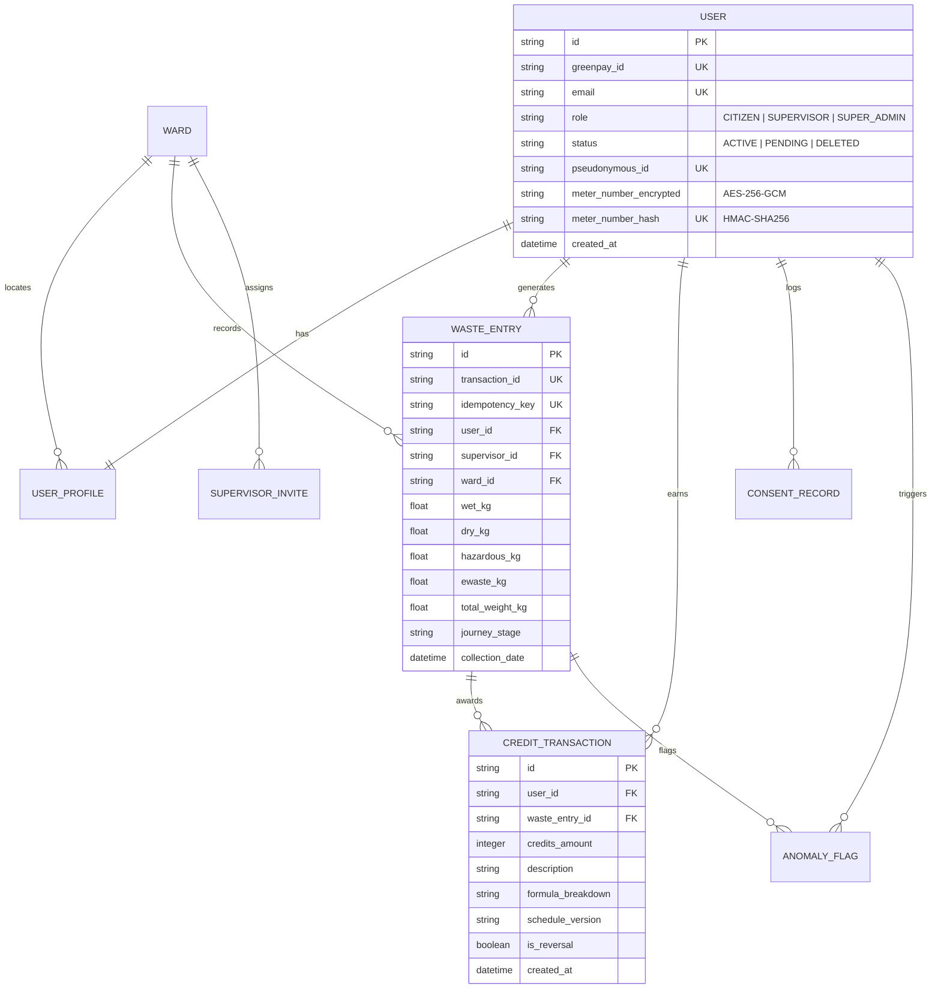

# GreenPay Database Schema & Immutability Architecture

## 1. Entity-Relationship Overview



---

## 2. Append-Only Database Triggers (Dual-Engine)

To guarantee ledger immutability and prevent fraud or retroactive tampering, physical database triggers prohibit all `UPDATE` and `DELETE` operations on `credit_transactions`.

### 2.1 SQLite Engine Trigger
```sql
CREATE TRIGGER IF NOT EXISTS trg_prevent_credit_ledger_update
BEFORE UPDATE ON credit_transactions
BEGIN
    SELECT RAISE(ABORT, 'Credit ledger transactions are append-only. Updates are strictly prohibited.');
END;

CREATE TRIGGER IF NOT EXISTS trg_prevent_credit_ledger_delete
BEFORE DELETE ON credit_transactions
BEGIN
    SELECT RAISE(ABORT, 'Credit ledger transactions are append-only. Deletions are strictly prohibited.');
END;
```

### 2.2 PostgreSQL Engine Trigger
```sql
CREATE OR REPLACE FUNCTION fn_prevent_credit_ledger_mutation()
RETURNS TRIGGER AS $$
BEGIN
    RAISE EXCEPTION 'Credit ledger transactions are append-only. Mutation (UPDATE/DELETE) is strictly prohibited.';
END;
$$ LANGUAGE plpgsql;

CREATE TRIGGER trg_credit_transactions_prevent_mutation
BEFORE UPDATE OR DELETE ON credit_transactions
FOR EACH ROW
EXECUTE FUNCTION fn_prevent_credit_ledger_mutation();
```

---

## 3. DPDP Act 2023 Pseudonymised Account Deletion (Amendment #2)

### 3.1 Statutory Context & Engineering Challenge
Under the **Digital Personal Data Protection Act 2023 (Section 12)**, citizens have the legal right to erasure of personal data. However, municipal audit regulations require that verified collection totals, waste tonnages, and civic reward allocations remain historically auditable. 

Furthermore, our database-level triggers **physically forbid** deleting rows from `credit_transactions`. Attempting to delete ledger rows triggers an abort error.

### 3.2 Pseudonymisation Protocol
When a citizen requests account erasure, GreenPay executes a permanent pseudonymisation protocol:

1. **PII Scrubbing**:
   - `User.email` is set to `NULL`.
   - `User.phone_number` is set to `NULL`.
   - `UserProfile.name` is replaced with `"[DELETED CITIZEN]"`.
   - `UserProfile.phone_number` is set to `NULL`.
   - `User.hashed_password` is overwritten with an unmatchable cryptographically random string.
2. **Cryptographic Erasure of Meter**:
   - `User.meter_number_encrypted` (AES-256 ciphertext) is permanently overwritten with `NULL`.
   - `User.meter_number_hash` (HMAC lookup index) is permanently overwritten with `NULL`.
3. **Pseudonymous Ownership Assignment**:
   - `User.pseudonymous_id` is assigned a random identifier: `ANON-<UUID>`.
   - `User.status` is set to `"DELETED"`.
4. **Ledger Immutability Preservation**:
   - `credit_transactions` and `waste_entries` remain completely intact with their original foreign key references.
   - Because the linked user profile is scrubbed of all PII and meter references, **no entity (including municipal auditors or database administrators) can ever re-link historical collections back to the real individual**.

This design satisfies both Section 12 erasure requirements and statutory public utility audit mandates.

---

## 4. Indexing Strategy

| Table | Index Columns | Type | Purpose |
| :--- | :--- | :--- | :--- |
| `users` | `greenpay_id` | Unique B-Tree | Citizen QR scanning & lookup |
| `users` | `meter_number_hash` | Unique B-Tree | Fast meter lookup without decrypting |
| `users` | `email` | Unique B-Tree | Login credential resolution |
| `credit_transactions` | `user_id`, `created_at` | Composite B-Tree | Rapid citizen ledger pagination |
| `waste_entries` | `idempotency_key` | Unique B-Tree | Offline queue duplicate prevention |
| `waste_entries` | `ward_id`, `collection_date` | Composite B-Tree | High-speed ward analytics and aggregation |
| `audit_logs` | `timestamp` | Descending B-Tree | Chronological audit trail review |
